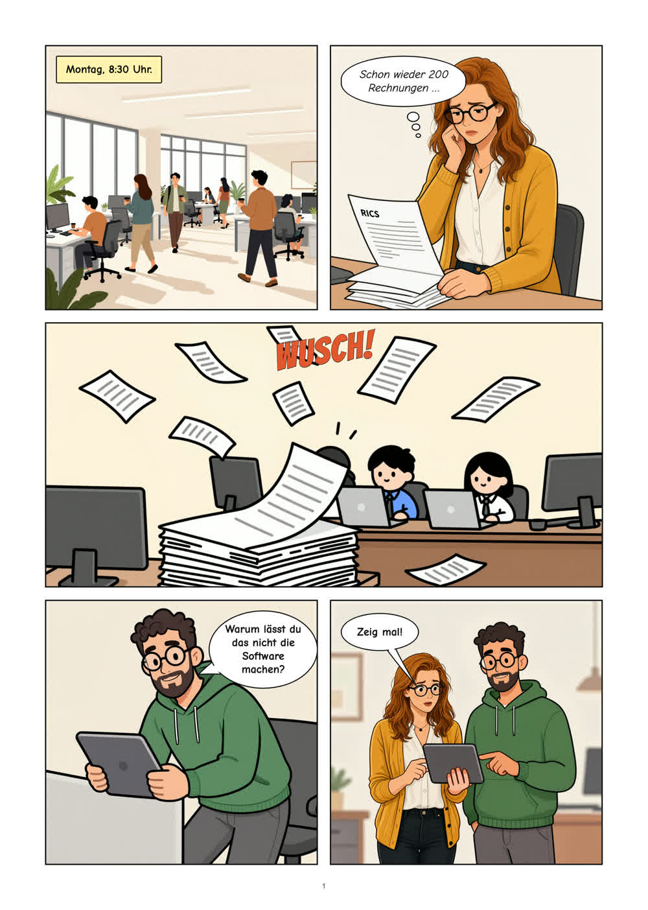

# comgen – Comics mit Claude Code + ComfyUI

Claude Code entwickelt Story und Seiten-Skript, macht aus **Fotos echter Personen
Comicfiguren**, lässt die Panels in **ComfyUI** zeichnen und setzt die Seiten mit
Sprechblasen – als PNG und PDF für **Druck, Web und Social**. Lokal, ohne Cloud-Kosten.

```
Briefing ─▶ Figuren ─────────▶ Story ─▶ Skript ──────▶ Panels ──────────▶ Lettering ─▶ Review ─▶ PNG/PDF
  (Claude)   Foto → Comicfigur  (Claude) comic.json      Z-Image + Figuren   Blasen, Kästen,
             (Qwen Image Edit)           Seiten/Panels   einsetzen (Qwen)    Soundwörter (Chrome)
```

| Foto → Comicfigur (3 Varianten) | Fertige Seite (A4, Testlauf) |
|---|---|
|  |  |

Anna entstand aus einem (generierten) Foto, Max aus einer Beschreibung; beide wurden per
Figurentausch in die Panels eingesetzt, Blasen und Texte setzt `tools/layout.py`.

## Prinzip: ein Klon = ein Comic

Dieses Repo ist ein **Template**. Für jeden Comic klonst du es in einen eigenen Ordner und
initialisierst es. Der Klon wird zum Git-Repo *dieses* Comics: Brief, Story und `comic.json`
sind versioniert; Fotos, Bilder und Seiten sind git-ignoriert.

```
comgen (Template)                   mein-comic (Klon)
├── .claude/skills/ ─┐              ├── .claude/ tools/ comfy/ …   ← Template-Code
├── tools/           │  git clone   └── comic/                     ← gehört dem Comic
├── comfy/workflows/ ├───────────▶      ├── brief.md  story.md  comic.json
├── templates/       │  init.sh         ├── cast/<id>/photo.jpg   (Fotos, ignoriert)
├── fonts/           │                  ├── assets/cast/<id>.png  (Comicfiguren)
└── scripts/        ─┘                  ├── assets/panels/        (Panel-Bilder)
                                        └── pages/                (PNG je Seite, PDF)
```

## Schnellstart

Einmalig pro Rechner:

```bash
scripts/setup.sh
```

Pro Comic:

```bash
git clone https://github.com/mchytracek/comgen.git rechnungs-comic && cd rechnungs-comic
```

```bash
scripts/init.sh "Wie Rechnungen sich selbst buchen" --format print-a4 --style explainer
```

`init.sh` legt `comic/` an, fragt nach dem ComfyUI-Server (Enter = lokal bzw. zuletzt
gewählt), benennt `origin` in `template` um und committet. Optionen: `--format`, `--style`,
`--purpose explainer|story|product|social`, `--lang`, `--comfy-url`, `--keep-origin`, `--no-commit`.

Dann Claude Code im Ordner starten:

> /comic Erklär-Comic, 4 Seiten A4, wie unsere Software Rechnungen automatisch bucht.
> Hauptfigur ist Anna (Foto: ~/Desktop/anna.jpg), ihr Kollege Max hilft ihr.

## Figuren aus Fotos

Das Herzstück: Personen werden einmal in den Comicstil übertragen und tauchen dann in
jedem Panel als dieselbe Figur auf.

```bash
python3 tools/cast.py add anna ~/Desktop/anna.jpg --name "Anna" --role "Buchhalterin" \
  --look "woman in her thirties, wavy auburn hair, round glasses, mustard cardigan"
```

1. Das Foto wird nach `comic/cast/anna/` kopiert und **automatisch** in drei Varianten im
   Comicstil gerendert (Qwen Image 2.1 Edit); Variante 1 wird vorläufig Referenz.
2. Vergleich: `comic/review/cast/anna/grid.png` (Foto links). Andere Variante wählen:
   `python3 tools/cast.py pick anna 2`; mehr Varianten: `cast.py render anna --seeds 4,5,6`.
3. Ab jetzt beziehen sich Story und Panels auf `anna`:
   `"cast": [{"id": "anna", "expression": "delighted"}]`, `"who": "anna"`.

Figuren ohne Foto: `cast.py add max --name Max --look "lanky man, curly hair, green hoodie"`.
`look` (englisch) beschreibt das Aussehen für den Bildaufbau – Claude schreibt ihn nach
Ansicht des Fotos. **Fotos nur mit Einverständnis der Personen verwenden.**

## Seiten, Panels, Blasen

Alles steht in `comic/comic.json` (Schema: `schemas/comic.schema.json`):

```json
{ "id": "p01", "layout": [[1, 1], [2], [1, 1]], "panels": [
  { "id": "p01-1", "shot": "medium", "prompt": "an office desk buried under paper invoices",
    "cast": [{ "id": "anna", "expression": "overwhelmed" }],
    "bubbles": [{ "type": "thought", "who": "anna", "text": "Schon wieder 200 Rechnungen …",
                  "pos": "tr", "tail": { "x": 0.42, "y": 0.38 } }] } ] }
```

- Raster: Zeilen mit relativen Breiten oder benannt (`python3 tools/comic.py layouts`).
- Blasen: `speech`, `thought`, `whisper`, `shout`, `caption` (Erzählerkasten), `sfx` (Lautmalerei).
- Text kommt **nie** aus dem Bildmodell – `tools/layout.py` setzt ihn scharf und änderbar.

## Werkzeuge

```bash
python3 tools/comic.py validate|show|formats|styles|layouts
python3 tools/cast.py add|render|pick|list
python3 tools/panels.py [--page p02] [--only p02-3] [--force|--reswap] [--dry-run]
python3 tools/panels.py grid p02-3      # Koordinatenraster für Blasen-Zeiger
python3 tools/layout.py [--page p01] [--pdf]   # Seiten → comic/pages/ (auch ohne Bilder: Rohlayout)
python3 tools/layout.py sheet           # Übersicht → comic/review/sheet.png
scripts/doctor.sh                       # Diagnose
```

## Formate

| `--format` | Ausgabe |
|------------|---------|
| `print-a4` | 2550×3578 px (300 dpi) + PDF 216×303 mm inkl. 3 mm Beschnitt, Seitenzahlen |
| `print-us` | US-Comicformat 6.625×10.25 in + Beschnitt |
| `web` | 1600×2400 px |
| `social-4x5` | 1080×1350 px (Instagram/LinkedIn-Karussell) |
| `social-1x1` | 1080×1080 px |
| `social-9x16` | 1080×1920 px (Stories/Reels) |

Stile (`--style`, `templates/styles.json`): `explainer`, `ligne-claire`, `us-comic`, `manga`, `graphic-novel`.

## ComfyUI auf einem anderen Rechner

Wie in vidgen: `scripts/init.sh --comfy-url http://gpu-box:8188` schreibt `.comgen.env`
(git-ignoriert); Reihenfolge `$COMFYUI_URL` > `.comgen.env` > `~/.config/comgen/env` >
`~/.config/vidgen/env` > lokal. Auf dem Server `python main.py --listen 0.0.0.0` und die
Modelle installieren; nur im LAN/VPN betreiben (ComfyUI hat keine Anmeldung).

## Voraussetzungen

| Komponente | Zweck |
|------------|-------|
| ComfyUI (lokal oder entfernt) mit Z-Image Turbo, Qwen Image 2.1 Turbo Edit | Panels, Figuren (Modelle: `comfy/workflows/README.md`) |
| `comfy-cli` + `comfy-mcp` | Steuerung von ComfyUI |
| Chrome / Chromium / Edge | Seitenlayout und PDF (headless, eigenes Profil) |
| FFmpeg | Fotos skalieren, Vergleichsbilder, Übersicht |
| Python 3.10+ | Tools (nur Standardbibliothek) |

## Lizenzen

- Schriften in `fonts/`: Comic Neue, Bangers – SIL Open Font License (Lizenztexte daneben).
- Modelle (Z-Image, Qwen Image) haben eigene Lizenzen – vor kommerzieller Nutzung prüfen.
- comfy-mcp: AGPL-3.0 oder kommerziell – wird nur als Werkzeug ausgeführt.
- Persönlichkeitsrechte: Fotos und Darstellung realer Personen nur mit Einverständnis.
